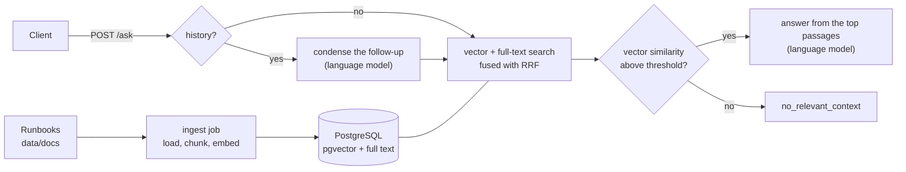

# On-call RAG

[](https://github.com/berkkaradalan/pwc-task/actions/workflows/ci.yml)

On-call RAG answers questions from on-call engineers using incident runbooks. Each answer
cites the runbook sections it was built from. When the runbooks do not cover a question,
the assistant says so instead of guessing.

## Features

- **Answers with sources.** Every answer lists the runbook passages it was built from, with
  their similarity scores. The sources come from retrieval, never from the model output.
- **Refuses when nothing relevant is found.** If no passage is similar enough, the API
  returns `no_relevant_context` with a fixed answer and does not call the language model.
- **Hybrid retrieval.** Vector search with pgvector and PostgreSQL full-text search are
  merged with Reciprocal Rank Fusion.
- **Follow-up questions.** The client sends the earlier turns, and a follow-up such as
  "Why not?" is rewritten into a standalone question before the search. A fallback covers
  the case where the model does not rewrite it.
- **Local or cloud models with one setting.** `RUN_MODE=local` runs Qwen3 models on Ollama
  without an account, and `RUN_MODE=cloud` uses OpenRouter.
- **Incremental ingestion.** Unchanged runbooks are not embedded again, and deleted ones are
  removed from the index.

## Prerequisites

- **Docker with Docker Compose 2.20 or later.** The Compose file uses optional dependencies
  (`depends_on: required: false`), which were introduced in 2.20, and a profile that `.env`
  switches on. The project was tested with Compose 2.40.
- **Local mode** needs about 4.4 GB of free memory once both models are loaded, and about
  3.1 GB of disk for the models, which are downloaded on the first start. The Ollama
  container is limited to 6 GB by `OLLAMA_MEMORY_LIMIT`. No account or key is needed.
- **Cloud mode** needs an [OpenRouter](https://openrouter.ai) API key with credits.
- **Development** also needs Python 3.12 and [uv](https://docs.astral.sh/uv/).

## Quickstart

Run all commands from the repository root. Local mode is the default:

```bash
cp .env.example .env    # then set POSTGRES_PASSWORD, and the same password in DATABASE_URL
docker compose up -d --build --wait api
```

This starts PostgreSQL and Ollama and pulls the two local models if they are missing. It
then indexes the runbooks in `data/docs` and starts the API on `127.0.0.1:8000`. The first
start takes several minutes, for the model download and about 65 s of ingestion on CPU.

For cloud mode, set two more values in `.env` before starting:

```bash
cp .env.example .env    # then set POSTGRES_PASSWORD and DATABASE_URL as above
# in .env: RUN_MODE=cloud and OPENROUTER_API_KEY=<your key>
docker compose up -d --build --wait api
```

Cloud mode starts only `db`, `ingest` and `api`, without Ollama.

Ask a question:

```bash
curl -s localhost:8000/ask -H 'Content-Type: application/json' \
  -d '{"question": "What is the maxmemory of redis-cache?"}'
```

```json
{
  "answer": "The `maxmemory` of `redis-cache` is 4 GB.",
  "status": "answered",
  "search_query": "What is the maxmemory of redis-cache?",
  "sources": [
    {
      "source": "redis-memory-pressure.md",
      "title": "Redis Memory Pressure",
      "heading_path": "Summary",
      "score": 0.762,
      "excerpt": "Quillbridge uses Redis 7, instance `redis-cache`, for merchant sessions and idempotency keys. The instance is configured with `maxmemory 4 GB`. When memory usage goes above 90% of `maxmemory`, the ..."
    }
  ]
}
```

This response comes from cloud mode. It had three more sources, which are left out here.

After editing documents, re-run ingestion. To rebuild the whole index, add `--reindex`:

```bash
docker compose run --rm ingest                                        # changed files only
docker compose run --rm ingest python -m oncall_rag.ingest --reindex  # drop and rebuild
```

`--reindex` is needed after changing `EMBEDDING_DIM` and recommended after changing the
chunk settings. A new embedding model or provider needs no flag, because ingestion then
rebuilds the index by itself.

`docker compose down` stops the stack and keeps the index volume.

## Running modes and switching

`RUN_MODE` in `.env` is the only switch. It selects the models, and through
`COMPOSE_PROFILES=${RUN_MODE}` in `.env` it also decides whether Compose starts the Ollama
services.

| | `local` (default) | `cloud` |
|---|---|---|
| Provider | Ollama in Compose, on CPU | OpenRouter |
| Embeddings | `qwen3-embedding:0.6b` | `qwen/qwen3-embedding-8b`, pinned to `EMBEDDING_PROVIDER` (DeepInfra) |
| Answers | `qwen3:4b-instruct-2507-q4_K_M` | `qwen/qwen3-30b-a3b-instruct-2507` |
| Answer latency | 30–50 s | about 7 s (median) |
| Needs | about 4.4 GB of free memory | `OPENROUTER_API_KEY` |

To switch modes, stop the stack before changing `RUN_MODE`:

```bash
docker compose down
# edit .env: RUN_MODE=cloud (with OPENROUTER_API_KEY) or RUN_MODE=local
docker compose up -d --build --wait api
```

The embedding model changes with the mode, so ingestion logs one warning and rebuilds the
index before the API starts.

If `RUN_MODE` was changed before `docker compose down`, the Ollama containers are no longer
in an active profile, and a plain `down` leaves them running. This command stops every
service:

```bash
docker compose --profile '*' down
```

## Architecture



Two services run as separate processes. Ingestion (`oncall_rag.ingest`) is a one-shot job,
and question answering (`oncall_rag.query`) is a FastAPI app built around a LangGraph
graph. They share only `oncall_rag.shared` and never import each other. Provider-specific
code for Ollama, OpenRouter and pgvector lives in adapters behind abstract ports, and each
service builds its adapters in one composition root.

[docs/architecture.md](docs/architecture.md) walks through both flows, the graph, the
ports, configuration, Compose, error handling, concurrency and the schema.
[docs/decisions.md](docs/decisions.md) explains why the system is built this way, and
[docs/evaluation.md](docs/evaluation.md) holds the measurements.

## API

Interactive API docs are served at `http://localhost:8000/docs`.

### `POST /ask`

The request body has two fields:

| Field | Type | Rules |
|---|---|---|
| `question` | string | 1–1000 characters after trimming whitespace |
| `history` | list, optional | earlier turns, oldest first; at most 10 messages, each `{"role": "user" \| "assistant", "content": <1–4000 characters>}` |

The response has four:

| Field | Meaning |
|---|---|
| `answer` | the answer, or `No relevant documentation was found for this question.` |
| `status` | `answered`, or `no_relevant_context` when no passage passed the similarity threshold and the language model was not called |
| `search_query` | the text that was searched: the question, the model's standalone rewrite of a follow-up, or the previous user question followed by the follow-up |
| `sources` | the passages used: `source` (file), `title`, `heading_path`, `score` (cosine similarity, 3 decimals) and `excerpt` (up to 200 characters) |

An unrelated question gets the fixed answer:

```bash
curl -s localhost:8000/ask -H 'Content-Type: application/json' \
  -d '{"question": "What is the capital of France?"}'
```

```json
{"answer":"No relevant documentation was found for this question.","status":"no_relevant_context","search_query":"What is the capital of France?","sources":[]}
```

A follow-up sends the earlier turns as `history`:

```bash
curl -s localhost:8000/ask -H 'Content-Type: application/json' -d '{
  "question": "Why not?",
  "history": [
    {"role": "user", "content": "Should I run FLUSHALL to fix Redis memory pressure?"},
    {"role": "assistant", "content": "No. Do not run FLUSHALL to fix Redis memory pressure."}
  ]
}'
```

In cloud mode, this returned `"search_query": "Why should I not run FLUSHALL to fix Redis
memory pressure?"` and four sources from `redis-memory-pressure.md`. The first was its
"Mitigation" section, with a score of 0.819.

### `GET /health`

The health check returns `200 {"status": "ok"}` when the database answers, and
`503 {"detail": "failed"}` otherwise. It never calls a model.

### Errors

Every response carries an `X-Request-ID` header, and the same ID appears in every log line
of that request.

| Status | Cause |
|---|---|
| 422 | invalid request body, for example an empty question or a `system` role in `history`; FastAPI's default body lists each field |
| 502 | the model provider rejected the request, for example because of a bad key, or returned an unusable answer |
| 503 | a model provider or the database is unreachable, rate-limited or failing, or no provider can serve the model, for example because the pinned embedding provider is down |
| 504 | a model provider did not answer in time; for the language model, the limit is `LLM_TIMEOUT_SECONDS` per attempt |
| 500 | anything unexpected: `{"detail": "Internal server error", "request_id": "..."}` |

The `detail` texts are fixed. The underlying error is only logged, and the log line names
the failed call, for example `embedding call to qwen/qwen3-embedding-8b@deepinfra`.

## Development

```bash
uv sync                         # Python 3.12 environment from uv.lock
uv run pytest --cov=oncall_rag  # unit tests: no network, no database (fakes in tests/fakes.py)
uv run ruff check .
uv run ruff format --check .
uv run mypy src                 # strict
uv lock --check
uv run pre-commit install       # ruff, whitespace fixes and gitleaks before each commit
```

To run the services on the host, start the Compose database and point them at it.
`DATABASE_URL` and `OLLAMA_BASE_URL` in `.env.example` already use the published ports:

```bash
docker compose up -d db                     # plus `ollama ollama-init` in local mode
uv run python -m oncall_rag.ingest
uv run uvicorn oncall_rag.query.main:app --no-access-log   # port 8000: stop the api container first
```

`scripts/e2e.sh` runs the end-to-end check on its own Compose stack. That stack uses the
project name `oncall-rag-e2e`, publishes no ports and always runs in local mode. The script
ingests `data/docs`, checks that chunks were indexed and starts the API. It then asks an
answerable question, an unrelated question and the FLUSHALL follow-up, using
`scripts/e2e_api_checks.py`. It needs a host folder for the Ollama models and about as much
memory as local mode, so stop the development stack first:

```bash
docker compose down
OLLAMA_MODELS_DIR=./.cache/ollama-models scripts/e2e.sh
```

The pgvector adapter is exercised by this script, not by the unit tests.

CI runs these checks, a Docker image scan and the end-to-end script on every push to `main`
and on every pull request. The CI jobs and the container-based checks are listed under
[Development checks](docs/architecture.md#development-checks).

## Known limitations

These are drawn from [docs/evaluation.md](docs/evaluation.md):

- **A symptom phrased differently from the runbook can still miss.** For the "payment still
  pending after a reload" question, the matching runbook ranks fifth, outside the top 4,
  and the answer blames the wrong cause.
- **Full-text search is English only.** Non-English questions rely on vector search alone.
- **The similarity threshold has narrow margins.** In cloud mode the margin is about 0.05
  on each side of 0.5. Re-check the threshold after changing the documents or an embedding
  model.
- **`answered` does not guarantee coverage.** When passages pass the threshold but do not
  contain the answer, the model says the documentation does not cover it, and the status is
  still `answered`.
- **Full-text matching is broad.** Any word of the question can match, and only the vector
  threshold keeps unrelated questions out.
- **Prompt rules are not always followed.** Answers have left out a follow-up escalation,
  kept a concrete service name instead of `<service>`, or used a list where prose was asked.
  This happens more often with the local 4B model.
- **Local mode is slow.** An answer takes 30–50 s on CPU, and longer after a model was
  unloaded.
- **Follow-ups use only the previous question.** Older turns are not added to the search,
  and a rewrite that drops the subject is not detected.
- **There is no authentication.** Compose publishes the API on `127.0.0.1` only, and access
  control is left to the deployment.

---

Built with AI coding assistants; every change was reviewed. The working conventions
are in [AGENTS.md](AGENTS.md).
