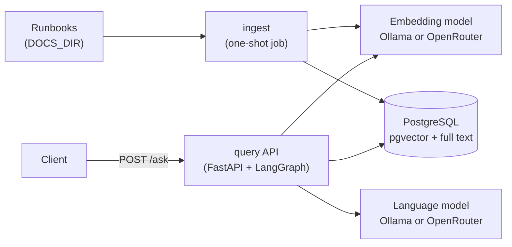
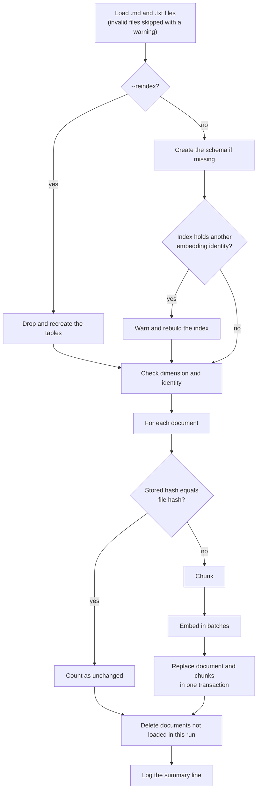
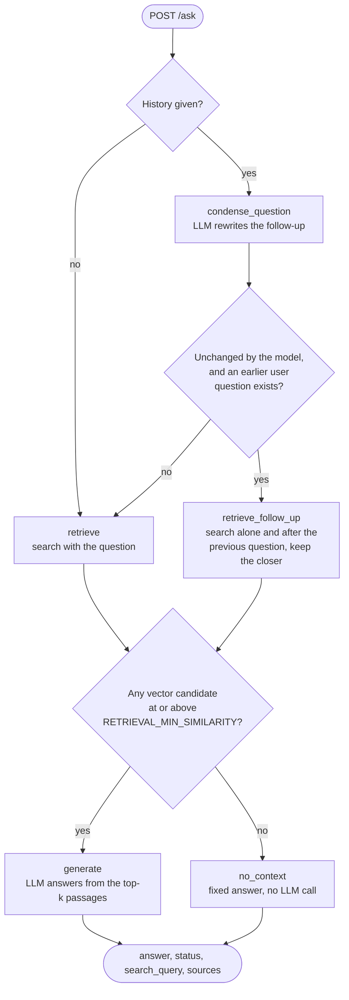
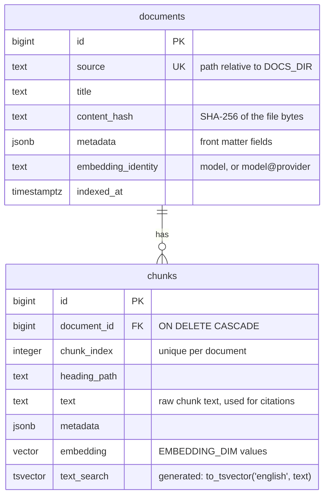

# Architecture

This document describes how On-call RAG is built. The reasons behind the design are in
[decisions.md](decisions.md).

## Services and packages

Two services run as separate processes and share only the `oncall_rag.shared` package:

| Service | Package | Runs as | Talks to |
|---|---|---|---|
| Ingestion | `oncall_rag.ingest` | one-shot job: `python -m oncall_rag.ingest [--reindex]` | embedding model, PostgreSQL |
| Question answering | `oncall_rag.query` | FastAPI app: `uvicorn oncall_rag.query.main:app --no-access-log` | embedding model, language model, PostgreSQL |

`ingest` and `query` never import each other. Each has one composition root,
`ingest/wiring.py` and `query/core/wiring.py`, which is the only place where concrete
adapters are built from settings.



## Ingestion flow

The pipeline in `ingest/pipeline.py` runs
`load -> prepare store -> skip unchanged -> chunk -> embed -> replace -> prune`.



1. **Load** (`ingest/loaders.py`). Ingestion reads every `.md` and `.txt` file under
   `DOCS_DIR`, recursively and sorted by path. Hidden files and folders are ignored. Bytes
   are decoded as UTF-8. A BOM is accepted, and CRLF line endings become LF. Optional YAML
   front matter is parsed with `python-frontmatter` and may set `title`, `service`,
   `owner_team` and `last_reviewed`. Without a title, the file name is used.

   A file with an unsupported extension, invalid UTF-8, malformed front matter or no
   content is skipped with a `WARNING`. Front matter without a YAML mapping is ignored with
   a warning, and the file is kept. A missing `DOCS_DIR` fails the run before anything is
   reset or pruned.
2. **Prepare the store.** `--reindex` drops and recreates the tables. Otherwise the schema
   is created if it is missing. If the index holds another embedding identity, the run logs
   `Embedding identity changed from <old> to <new>: rebuilding the index` and rebuilds it.
   In every case the store then checks the vector dimension and the identity.
3. **Skip unchanged.** Each document stores the SHA-256 of its raw file bytes. A document
   with the same hash is not chunked or embedded again.
4. **Chunk** (`ingest/chunker.py`). Markdown is split on H1–H3 headings by
   `ExperimentalMarkdownSyntaxTextSplitter`. Blocks under the same heading are joined
   again, and sections headed "Related runbooks" are dropped. A `.txt` file is one section.
   Sections longer than `CHUNK_MAX_CHARS` are split by `RecursiveCharacterTextSplitter` on
   paragraphs, lines, sentences and then words, with `CHUNK_OVERLAP_CHARS` of overlap. Each
   chunk keeps its heading path, for example `Mitigation > Rollback`.
5. **Embed.** The embedding text is `<title> > <heading path>`, a blank line, and then the
   chunk text. When a chunk has no heading, the title stands alone. Texts are sent in
   batches of `EMBEDDING_BATCH_SIZE`, and the length of every returned vector is checked
   against `EMBEDDING_DIM`.
6. **Replace.** In one transaction, the document row is upserted, its old chunks are
   deleted and the new ones are inserted.
7. **Prune.** Indexed documents that were not loaded in this run, because they were
   deleted or are now invalid, are deleted together with their chunks.
8. **Summary.** The run ends with
   `Ingestion finished: indexed=N unchanged=N skipped=N deleted=N`.

## Question answering flow

`POST /ask` validates the request. `AnswerService` then runs the compiled LangGraph graph
from `query/rag/graph.py` with a new state for this request.



### State

`RagState` in `query/rag/state.py` lives only for one invocation:

| Field | Set by | Meaning |
|---|---|---|
| `question` | request | the question as asked |
| `history` | request | earlier turns, oldest first |
| `search_query` | start, `condense_question`, `retrieve_follow_up` | the text that is embedded and searched; it starts as the question |
| `passages` | `retrieve`, `retrieve_follow_up` | the fused top-k passages, or an empty list when the gate stays closed |
| `answer`, `status` | `generate`, `no_context` | the response; the status is `answered` or `no_relevant_context` |

### Nodes and routing

- **Start.** Without history, the graph goes straight to `retrieve`. With history, it goes
  to `condense_question`.
- **`condense_question`** sends the question and the most recent history to the language
  model, with the condense prompt from `query/rag/prompts.py`. The history is trimmed to at
  most 4000 characters in total. If the reply equals the question apart from case and
  whitespace, the node logs `The follow-up was not rewritten` and keeps the question as the
  search query. Otherwise it logs `Condensed the follow-up into the search query '...'`
  and searches with the reply.
- **After condensing**, the graph goes to `retrieve_follow_up` if the search query is still
  the question and the history contains an earlier `user` message. Otherwise it goes to
  `retrieve`.
- **`retrieve`** embeds the search query with the Qwen3 query instruction. It then runs one
  SQL query that returns two candidate lists of up to 20 chunks each
  (`CANDIDATES_PER_METHOD`): the nearest chunks by cosine distance, and the best full-text
  matches. If no vector candidate reaches `RETRIEVAL_MIN_SIMILARITY`, `passages` is empty.
  Otherwise the two lists are fused with Reciprocal Rank Fusion in `query/rag/fusion.py`
  and cut to `RETRIEVAL_TOP_K`. Each chunk scores the sum of `1 / (60 + rank)` over the
  lists that contain it, and ties keep their first-seen order.
- **`retrieve_follow_up`** runs the same search twice: with the question alone, and with
  `<previous user question> <question>`. It keeps the search whose best vector candidate is
  strictly more similar, so a tie keeps the question alone. It logs which search it kept
  and sets `search_query` to it. The gate and the fusion work as in `retrieve`.
- **After retrieval**, passages lead to `generate`, and an empty list leads to `no_context`.
- **`generate`** sends the system prompt, the trimmed history as earlier chat messages, and
  a user message. That message holds the numbered passages, each as
  `[n] <title> > <heading path>` followed by its text, and then the original question. The
  call uses temperature 0.1 and at most 512 tokens.
- **`no_context`** returns `No relevant documentation was found for this question.`
  without calling the language model.

The sources in the response come from `passages`, never from the model output. Each source
shows its cosine similarity to the search query as `score`, rounded to 3 decimals, and an
excerpt of up to 200 characters.

## Ports and adapters

Ports are `abc.ABC` classes in `shared/ports.py`. Every adapter and every test fake
inherits from the ports it implements.

| Port | Used by | Adapter | Test fake |
|---|---|---|---|
| `Embedder` | ingest, query | `OpenAICompatibleEmbedder` (`shared/adapters/embeddings/openai_compatible.py`) | `FakeEmbedder` |
| `DocumentIndex` | ingest | `PgVectorStore` (`shared/adapters/vectorstore/pgvector.py`) | `InMemoryVectorStore` |
| `PassageSearch` | query | `PgVectorStore` | `InMemoryVectorStore` |
| `LanguageModel` | query | `OpenAICompatibleLLM` (`shared/adapters/llm/openai_compatible.py`) | `FakeLanguageModel` |

- **Embedding adapter.** It uses the `openai` SDK (`AsyncOpenAI`) against an
  OpenAI-compatible `/v1/embeddings` endpoint on Ollama or OpenRouter, with float encoding
  and `dimensions` set to `EMBEDDING_DIM`. A query to a Qwen3-Embedding model gets the
  prefix `Instruct: Given an on-call engineer's question, retrieve runbook passages that
  answer it`, followed by `Query:` and the text. Documents are sent as they are.

  When a provider is set, each request carries OpenRouter's routing field
  `{"provider": {"order": [<provider>], "allow_fallbacks": false}}`. The read timeout is
  120 s and the connect timeout 5 s. The SDK makes up to three attempts, retrying
  connection errors, timeouts, 408, 409, 429 and 5xx.
- **Language model adapter.** It uses the same SDK against `/v1/chat/completions`, with a
  timeout of `LLM_TIMEOUT_SECONDS` per attempt and one retry. An `asyncio.Semaphore` of
  `LLM_MAX_CONCURRENCY` surrounds each call. An empty answer raises `ProviderResponseError`.
- **pgvector store.** It uses an async `psycopg` connection pool. The schema is described
  below.

## Configuration

`shared/config.py` reads all settings with `pydantic-settings`, from the environment and
from `.env` in the working directory. A validation error names the setting and the reason,
never the value. `.env.example` lists every setting with a comment.

| Setting | Default | Notes |
|---|---|---|
| `DATABASE_URL` | required | inside Compose, set to the `db` service |
| `OLLAMA_BASE_URL` | required | inside Compose, set to the `ollama` service |
| `RUN_MODE` | `local` | `local` or `cloud` |
| `OPENROUTER_API_KEY`, `EMBEDDING_PROVIDER` | none | required when `RUN_MODE=cloud` |
| `LOCAL_EMBEDDING_MODEL`, `CLOUD_EMBEDDING_MODEL` | required | |
| `LOCAL_LLM_MODEL`, `CLOUD_LLM_MODEL` | required | query service only |
| `EMBEDDING_DIM` | 1024 | changing it needs `--reindex` |
| `EMBEDDING_BATCH_SIZE` | 32 | |
| `CHUNK_MAX_CHARS`, `CHUNK_OVERLAP_CHARS` | 1500, 200 | ingestion only; the overlap must be smaller |
| `DOCS_DIR` | `data/docs` | ingestion only |
| `RETRIEVAL_TOP_K`, `RETRIEVAL_MIN_SIMILARITY` | 4, 0.5 | query service only |
| `LLM_TIMEOUT_SECONDS` | 60 (120 in `.env.example`) | per attempt |
| `LLM_MAX_CONCURRENCY` | 4 | per API process |
| `DB_POOL_MAX_SIZE` | 10 | per API process; ingestion uses one connection |

`CommonSettings._endpoint` is the only place that turns `RUN_MODE` into a provider:

| | `local` | `cloud` |
|---|---|---|
| Base URL | `OLLAMA_BASE_URL` + `/v1` | `https://openrouter.ai/api/v1` |
| API key | a placeholder, which Ollama ignores | `OPENROUTER_API_KEY` |
| Embedding model | `LOCAL_EMBEDDING_MODEL` | `CLOUD_EMBEDDING_MODEL`, pinned to `EMBEDDING_PROVIDER` |
| Language model | `LOCAL_LLM_MODEL` | `CLOUD_LLM_MODEL`, not pinned |

## Compose services and profiles

`docker-compose.yml` defines the following services. Every published port is bound to
`127.0.0.1`.

| Service | Image | Profile | Role |
|---|---|---|---|
| `db` | `pgvector/pgvector:0.8.6-pg17-bookworm` | always | PostgreSQL with pgvector; volume `pgdata` |
| `ollama` | `ollama/ollama:0.40.5` | `local` | model server; volume `ollama`; memory limit `OLLAMA_MEMORY_LIMIT` (default `6g`) |
| `ollama-init` | `ollama/ollama:0.40.5` | `local` | pulls the two local models if they are missing, then exits |
| `ingest` | built from `Dockerfile` | always | one-shot ingestion of `./data/docs`, mounted read-only |
| `api` | built from `Dockerfile` | always | the query API on `127.0.0.1:${API_HOST_PORT}` (default 8000) |

- **Start order.** `ingest` waits for a healthy `db` and for `ollama-init` to complete.
  That dependency has `required: false`, so `ingest` does not wait for it in cloud mode.
  `api` starts only after `ingest` has completed successfully, so `docker compose up api`
  always indexes first.
- **Profiles.** `.env.example` sets `COMPOSE_PROFILES=${RUN_MODE}`. The `local` profile,
  and with it Ollama, is therefore on only when `RUN_MODE=local`.
- **Ollama limits.** `OLLAMA_NUM_PARALLEL=1` serves one request per model at a time.
  `OLLAMA_MAX_LOADED_MODELS=2` keeps exactly the two models loaded, and
  `OLLAMA_CONTEXT_LENGTH=4096` fixes the context size. Both models loaded need about
  4.4 GB, and past the memory limit only the Ollama container is killed. It has no restart
  policy.
- **Health checks.** `db` runs `pg_isready`, `ollama` runs `ollama list`, and `api` calls
  `GET /health` from inside the container.
- **Image.** The `Dockerfile` is a multi-stage build on `python:3.12.15-slim-bookworm` with
  uv 0.13.7. It installs the dependencies from `uv.lock` and runs as a non-root numeric
  user. The default command is ingestion, and the `api` service overrides it with uvicorn.
- **E2E override.** `compose.ci.yml`, used by `scripts/e2e.sh`, sets its own project name
  `oncall-rag-e2e` and removes the published ports. It forces `RUN_MODE=local` and keeps
  the Ollama models in a host folder (`OLLAMA_MODELS_DIR`), so CI can cache them.

## Error handling

Adapters let `openai` and `psycopg` exceptions propagate unchanged. They add a note that
names the call, such as `embedding call to qwen/qwen3-embedding-8b@deepinfra` or
`LLM call to <model>`. `shared/logging.failure_summary` joins the notes and the error text
for the log line, for example `Answering failed: embedding call to
qwen/qwen3-embedding-8b@deepinfra: Connection error.`

The application defines two exceptions in `shared/errors.py`. `ReindexRequiredError` means
the index is missing, or was built with another identity or dimension.
`ProviderResponseError` means a provider answered, but the answer is unusable: it was
empty, or a vector had the wrong length.

The `/ask` route translates exceptions into a short, fixed `detail`. The exception text,
which may name internal hosts, is only logged.

| Status | Cause |
|---|---|
| 422 | invalid request body; FastAPI's default body lists each field |
| 502 | `openai.APIStatusError` not listed below, or `ProviderResponseError`: the provider rejected the request, for example because of a bad key, or returned an unusable answer |
| 503 | `APIConnectionError`, `NotFoundError`, `RateLimitError`, `InternalServerError` or `psycopg.OperationalError`; on OpenRouter, `NotFoundError` means no provider can serve the model, for example because the pinned one is down |
| 504 | `APITimeoutError` |
| 500 | anything else: `{"detail": "Internal server error", "request_id": "..."}`, with the traceback in the logs under the same request ID |

`GET /health` returns `200 {"status": "ok"}` when the database answers `SELECT 1`, and
`503 {"detail": "failed"}` otherwise. It never calls a model.

The API refuses to start, and logs the reason, when the index has not been built, holds
another embedding identity, or has another vector dimension.

Ingestion exits with one of three codes (`ingest/__main__.py`):

| Code | Cause |
|---|---|
| 0 | success |
| 1 | `ReindexRequiredError` (logged with a hint to run `--reindex`), a missing `DOCS_DIR`, `ProviderResponseError`, any `openai` error or any `psycopg` error |
| 2 | invalid configuration |

## Concurrency

This section answers the five scaling questions for this codebase. Each subsection separates
what is implemented from the next steps. Measured results are in
[evaluation.md](evaluation.md). Everything else here is design reasoning.

### Request isolation

Implemented:

- **Shared graph, per-request state.** The graph is compiled once at startup and shared by
  all requests. It holds only the adapters and the retrieval settings. Each request runs
  `graph.ainvoke()` with a new state, and the server stores no conversation. There is no
  module-level mutable state, and `app.state` holds only the objects built at startup.
- **No shared connections mid-query.** Each store call borrows a pooled connection for one
  statement or one transaction and returns it, so two requests never share a connection
  while a query runs.
- **Request IDs.** `asgi-correlation-id` reuses a valid UUID from the `X-Request-ID` header
  or generates one, and returns it in `X-Request-ID`. The ID lives in a context variable,
  so concurrent requests never see each other's ID. A logging filter adds it to every API
  log line, and one access log line per request records the method, path, status and
  duration.

In the concurrency test, 24 requests sent at once all returned `200`, and no response
contained another request's search query.

### Parallel execution

Implemented:

- **Async I/O.** A question waits in three places: the embedding call, the PostgreSQL
  query and the language model call. All three use async clients (`AsyncOpenAI` and the
  async `psycopg` pool), so while some requests wait for the language model, one process
  keeps serving health checks, retrieval and `no_relevant_context` answers. The API does
  no CPU-heavy work of its own. Building a prompt is string formatting.
- **Language model limit.** An `asyncio.Semaphore` in the adapter lets at most
  `LLM_MAX_CONCURRENCY` language model calls run at once per API process.
- **Ingestion as a separate process.** Ingestion is a one-shot job, not part of the API. It
  does the heavy work of parsing and embedding every changed document, so it never blocks
  the API's event loop or holds API connections.

Next steps:

- **Parallel calls inside a request.** `retrieve_follow_up` runs its two searches one
  after the other, and ingestion embeds its batches one at a time. Both could run with
  `asyncio.gather`, within the provider's rate limits.
- **More worker processes** only once the model backend has spare capacity. Every worker
  gets its own semaphore and pool, so the limits must be divided between them (see Multiple
  instances).
- **Ingestion as a background job with a lock.** A PostgreSQL advisory lock around a run
  would keep two ingestions from racing on the same documents.

### Resource limits

Implemented:

- **Concurrent model calls.** The semaphore above caps language model calls per process.
  Further calls wait in the process.
- **Timeouts.** `LLM_TIMEOUT_SECONDS` per language model attempt, 120 s read and 5 s
  connect for embeddings, and 10 s to connect to PostgreSQL or to get a free pooled
  connection.
- **Transient errors and API limits.** The `openai` SDK retries connection errors,
  timeouts, 408, 409, 429 and 5xx: once for the language model, and up to three attempts
  for embeddings. When the retries are used up, the API answers `503` (unreachable,
  rate-limited or failing) or `504` (timeout), so a client can tell "try again later" from
  "too slow". This happened once in the evaluation: a provider answered `429` after two SDK
  retries, and the API returned `503`.
- **Database pool.** `psycopg-pool` opens at most `DB_POOL_MAX_SIZE` connections per
  process. Connections broken by a database restart are replaced before they are handed
  out.
- **Ollama.** In local mode, Ollama serves one request per model at a time
  (`OLLAMA_NUM_PARALLEL=1`) and runs under a memory limit (`OLLAMA_MEMORY_LIMIT`).

Next steps:

- **Fail fast on overload.** There is no bounded wait for the semaphore. Under overload,
  requests queue until they time out. A bounded wait that answers `503` with `Retry-After`
  would fail fast and predictably.
- **Match the limit to the backend.** In local mode, with `LLM_MAX_CONCURRENCY=4`, the
  fourth question waits for three answers inside Ollama and can reach
  `LLM_TIMEOUT_SECONDS`. Setting the limit to the backend's real capacity (1 for local
  Ollama) moves that wait into the API, where a bounded wait can handle it.
- **Different retry budgets.** The API should fail fast, while ingestion is a batch job that
  can wait out a rate limit. Both use the same embedding adapter today, with the same
  retries.
- **A restart policy for `ollama`**, so a container killed at its memory limit comes back.

### Multiple instances

Stateless, so any number of instances can serve the same requests:

- the API itself: no sessions and no local files;
- conversation history, which the client sends with each request;
- the graph state, which lives only for one request.

Shared and persistent: the PostgreSQL index (documents, chunks, vectors and full text).
Every instance answers from the same data, and each document is replaced in one
transaction, so no instance sees a half-updated document.

What multiplies or breaks per instance, with the fix for each:

- **The semaphore and the pool are per process.** Three instances with
  `DB_POOL_MAX_SIZE=10` hold up to 30 of PostgreSQL's default 100 connections, and three
  semaphores allow three times `LLM_MAX_CONCURRENCY` model calls. Divide the limits by the
  number of instances, and add a concurrency limit shared by all instances if the provider
  enforces a global rate limit.
- **Ingestion runs can overlap.** In Compose, `api` starts only after `ingest` has
  completed, but nothing stops two ingestions started by hand or by two deployments. A
  PostgreSQL advisory lock around a run fixes that.
- **`--reindex` drops the tables**, so every instance fails while it runs. Building the new
  index next to the old one and switching over would avoid that downtime.

### Bottlenecks

The main bottleneck is language model generation. Locally, an answer takes 30–50 s on CPU,
and with `OLLAMA_NUM_PARALLEL=1` answers are generated one at a time. In cloud mode,
provider rate limits are the limit: `429` responses were seen both on `/ask` and during
ingestion. Retrieval takes one embedding call and one indexed query, and PostgreSQL and the
index are not a bottleneck at this scale (16 runbooks, 103 chunks).

Today only the logs exist. The metrics to expose and watch:

- latency per graph node (`condense_question`, `retrieve`, `generate`), to see where time
  goes;
- semaphore wait time, which shows when the model is the queue;
- language model and embedding errors by type (`429`, `5xx`, timeouts, `503`/`504` sent to
  clients);
- database pool wait time and connections in use;
- the share of `no_relevant_context` answers, which rises with documentation gaps or a
  threshold set too high;
- token usage and cost per answer in cloud mode.

The order in which to improve the system, and why:

1. **Use the cloud model or a GPU host for answers.** It removes the largest latency with a
   configuration change only.
2. **Bounded semaphore wait with `503` and `Retry-After`.** Overload then fails fast and
   predictably instead of piling up timeouts.
3. **Expose the metrics above.** Every later step needs them to show whether it helped.
4. **Stream answers to the client.** The user sees text after the first tokens instead of
   after the whole answer.
5. **Cache answers to repeated questions**, keyed by the normalized question and the index
   content. During an incident, many people ask the same thing.
6. **Run embeddings on a separate Ollama instance from the answering model.** Locally, both
   compete for the same CPU.
7. **Add API replicas.** This is worthwhile only once the model backend is no longer the
   limit, because all replicas share it.

## Database schema

Ingestion creates the schema with `CREATE TABLE IF NOT EXISTS`, and the vector dimension
comes from `EMBEDDING_DIM`. The application also creates the `vector` extension.



There are two indexes: `chunks_embedding_hnsw_idx` (HNSW with `vector_cosine_ops`) and
`chunks_text_search_gin_idx` (GIN on `text_search`).

## Project structure

```
src/oncall_rag/
├── shared/                  # used by both services
│   ├── config.py            # settings; resolves RUN_MODE to endpoints and models
│   ├── logging.py           # log format, failure_summary
│   ├── errors.py            # ReindexRequiredError, ProviderResponseError
│   ├── models.py            # Document, Chunk, Passage, SearchCandidates, ChatMessage
│   ├── ports.py             # Embedder, DocumentIndex, PassageSearch, LanguageModel
│   └── adapters/            # embeddings, llm, vectorstore (pgvector)
├── ingest/
│   ├── __main__.py          # entry point, exception -> exit code
│   ├── wiring.py            # composition root
│   ├── loaders.py           # files, front matter, validation
│   ├── chunker.py
│   └── pipeline.py
└── query/
    ├── main.py              # app factory and lifespan
    ├── core/                # middleware, dependencies, composition root
    ├── routers/             # POST /ask, GET /health
    ├── services/            # AnswerService: runs the graph, builds the response
    ├── schemas/             # request and response bodies
    └── rag/                 # graph, state, prompts, rank fusion
tests/                       # mirrors src/oncall_rag; fakes.py, fixtures/docs/
scripts/                     # e2e.sh, e2e_api_checks.py
data/docs/                   # the 16 sample runbooks (15 Markdown, 1 plain text)
```

## Development checks

CI runs `.github/workflows/ci.yml` on pushes to `main` and on pull requests:

| Job | Steps |
|---|---|
| `lint` | `uv lock --check`, ruff check and format, mypy, hadolint, `docker compose config -q`, actionlint, gitleaks over the full history |
| `test` | `uv run pytest --cov=oncall_rag`, coverage summary |
| `build` | image build, Trivy scan that fails on fixable CRITICAL vulnerabilities |
| `e2e` | `scripts/e2e.sh` in local mode, with the Ollama models cached between runs |

The container-based checks run locally with the same tools and versions:

```bash
docker run --rm -i hadolint/hadolint:v2.15.1 < Dockerfile
docker compose config -q
docker run --rm -v "$PWD:/repo:ro" -w /repo rhysd/actionlint:1.7.12
docker run --rm --user "$(id -u):$(id -g)" -v "$PWD:/repo:ro" \
  zricethezav/gitleaks:v8.30.1 git --redact --no-banner /repo
docker build -t oncall-rag:ci .
docker run --rm -v /var/run/docker.sock:/var/run/docker.sock \
  aquasec/trivy:0.76.1 image --severity CRITICAL --ignore-unfixed --exit-code 1 oncall-rag:ci
```
